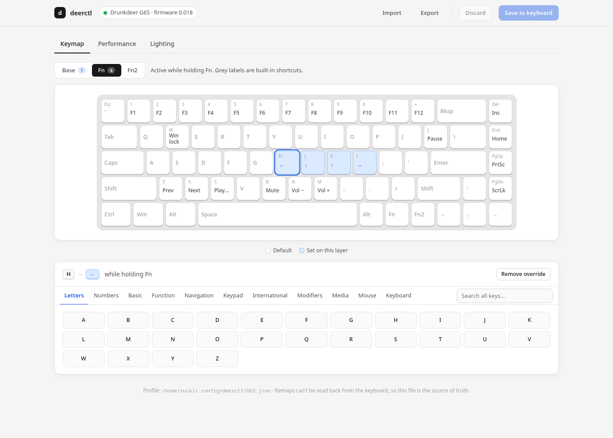
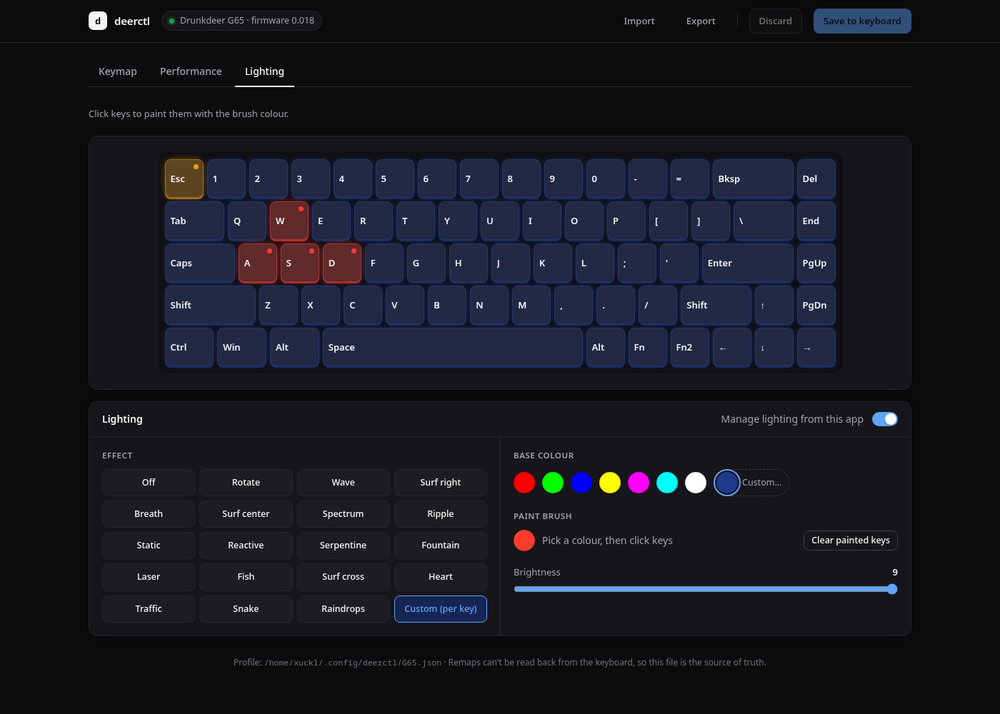

# deerctl

**Remap, tune and light up Drunkdeer magnetic keyboards on Linux and macOS.**



Drunkdeer's own configuration tool is a web app (the *Antler* driver at drunkdeer-antler.com) that talks to the keyboard over WebHID. Its desktop updater runs only on Windows. On Linux the web driver usually can't even see the keyboard, and it keeps your settings only in one browser's storage.

deerctl is a small, dependency-free (on Linux) Python tool that speaks the keyboard's protocol directly. It offers:

- **A graphical editor** that opens in any browser (Firefox and Safari included): `deerctl gui`
- **A command line** for scripting and dotfiles: `deerctl map capslock=lctrl`
- **Plain-JSON profiles** you can version, share and re-apply on any machine

Everything is written to the keyboard itself, so your remaps work everywhere, even without deerctl running.

> Unofficial project, not affiliated with or endorsed by Drunkdeer. The protocol, layouts and default keymaps were reverse-engineered from Drunkdeer's Antler web driver; see [Attribution](#attribution).

## What it can do

| Feature | Details |
|---|---|
| Key remapping | Base layer, **Fn** layer and **Fn2** layer, on any key |
| Targets | Letters, numbers, symbols, F1–F24, navigation, keypad, international keys, modifiers, Fn/Fn2, media keys, mouse buttons and wheel, lighting controls, Win-lock, Rapid-Trigger toggle, disable, or any raw HID usage (`hid:0x46`) |
| Actuation point | All keys or per key, in mm; the range is detected from model and firmware |
| Rapid Trigger | On/off, press and release sensitivity |
| Lighting | Every built-in effect (breath, wave, ripple, reactive…), 7 preset colours or rainbow, brightness and speed 0–9, or **any colour per key** |
| Profiles | JSON import/export, `deerctl apply file.json` |
| Other | Model and firmware info, factory reset |

Not implemented (yet): macros, last-win / RDT modes, the "turbo" lighting mode, firmware updates.

## Supported models

The layout and default keymap of every model the official web driver knows about are included (`src/deerctl/models.json`, generated from the driver by `tools/extract_models.py`). deerctl detects the model automatically from the keyboard's identity reply.

| Model | Identity | Keys |
|---|---|---|
| G65 (ANSI) | 11·2·1, 15·1·1 | 68 |
| G65 Lite, G65 M1/M2/M3 | 11·2·5, 11·2·3, 11·16·1, 11·18·1 | 68 |
| G60 (ANSI) | 11·3·1 | 61 |
| G60 M1/M2/M3 | 11·3·3, 11·19·1, 11·21·1 | 61 |
| X60 | 11·6·5 | 83 |
| G75 / G75 JP | 11·4·5 / 11·4·7 | 84 / 86 |
| A75 / A75 Pro | 11·4·1 (also 11·1·1) / 11·4·3 | 83 |
| A75 ISO (UK layout) | 11·4·2 | 83 |
| A75 Ultra / A75 Master | 11·4·4 / 11·5·4 | 86 / 85 |

USB IDs recognised: any `352d:*` (Drunkdeer), plus `05ac:024f` (A75 in Mac mode).

**Testing status:** every packet encoder (keymap, actuation, Rapid Trigger, lighting) is verified byte-for-byte against the official driver's own code.

On real hardware (G65 ANSI, firmware 0.018, Linux) these have been confirmed:
- model detection
- base, Fn and Fn2 layer remaps, captured at the USB level
- media-key remaps on the base layer
- built-in Fn shortcuts kept for keys you don't override
- lighting effects

All models share the same protocol, so the others should work, but they haven't been tried on real hardware. Reports (working or not) are very welcome. Please include the output of `deerctl info`.

Known gaps: ISO variants share one identity, so French/German A75 ISO boards currently get the UK key labels (the remap itself is position-based and still works). Some ISO-only keys on other boards may be missing from the layout.

## Install

```sh
git clone https://github.com/xuckless/deerctl
cd deerctl
pipx install .                 # or: python3 -m pip install --user .
```

**Linux, one time only:** give your user access to the keyboard, then replug it.

```sh
sudo "$(command -v deerctl)" install-udev
```

This installs `/etc/udev/rules.d/70-drunkdeer.rules`:

```
SUBSYSTEM=="hidraw", ATTRS{idVendor}=="352d", TAG+="uaccess", MODE="0660"
```

Bonus: this also makes the **official web driver work in Chrome/Chromium on Linux**. Without it, WebHID can't open the device, which is why the site "doesn't detect" the keyboard.

**macOS:** the `hidapi` dependency is installed automatically. If the keyboard can't be opened, allow your terminal under *System Settings → Privacy & Security → Input Monitoring*.

Requires Python 3.9+.

## Usage

### Graphical editor

```sh
deerctl gui
```

This opens `http://127.0.0.1:<port>`. Click a key, pick what it should do, then press **Apply to keyboard**. The page talks only to the local deerctl process; it is bound to 127.0.0.1 and protected by a per-session token.



### Command line

```sh
deerctl info                                    # model, firmware, current mode
deerctl layout                                  # physical key ids for your board
deerctl keys                                    # everything a key can be mapped to

deerctl map capslock=lctrl                      # remap, applied immediately
deerctl map ralt=menu fn2=rctrl
deerctl map -l fn1 h=left j=down k=up l=right   # Fn + HJKL = arrows
deerctl map -l fn1 m=mute comma=vol-down period=vol-up
deerctl unmap capslock                          # back to default
deerctl reset-keymap                            # clear all remaps
deerctl show                                    # print the current profile

deerctl actuation 1.2                           # all keys, in mm
deerctl actuation 0.6 --keys w,a,s,d
deerctl rt on --press 0.2 --release 0.2         # Rapid Trigger
deerctl rt off

deerctl light --list                            # effects for your board
deerctl light breath --color cyan -b 9 -s 5     # effect, colour, brightness, speed
deerctl light static --color '#ff8800'          # any colour (per-key mode)
deerctl light -k w=red -k a=red -k s=red -k d=red --color '#101830'  # paint keys
deerctl light off

deerctl export my-board.json
deerctl apply my-board.json
deerctl factory-reset
```

### Profile format

Profiles live in `~/.config/deerctl/<MODEL>.json` (macOS: `~/Library/Application Support/deerctl/`) and are easy to edit by hand:

```json
{
  "model": "G65",
  "layers": {
    "base": { "capslock": "lctrl" },
    "fn1":  { "h": "left", "j": "down", "k": "up", "l": "right" },
    "fn2":  {}
  },
  "actuation": { "default": 1.5, "keys": { "w": 0.8 } },
  "rapid_trigger": { "enabled": true, "press": 0.2, "release": 0.2 },
  "lighting": { "effect": "breath", "color": "cyan", "brightness": 9, "speed": 5 }
}
```

### Things to know

- **The profile file is the source of truth.** The keyboard can't report its remaps back (the official driver keeps them in browser storage for the same reason), so every apply rewrites all three layers. Remaps made earlier with the web driver are replaced.
- **Fn layers:** keys you don't set keep the keyboard's built-in Fn functions.
- **Actuation, Rapid Trigger and lighting** are only written once you set them, so the keyboard's current values stay untouched until then.

### G65 notes

- The key printed **Menu** (right of the right-hand Fn) is **Fn2**.
- Built-in **Fn** shortcuts (kept unless you override them):
  - Esc = \` ~; 1–0, −, = = F1–F12
  - Del = Insert; End = Home; PgUp = PrtSc; PgDn = ScrLk; ] = Pause
  - Z / X / C = previous / next / play; B = mute; N / M = volume − / +
  - W = Win-lock
- Built-in **Fn2** shortcuts:
  - R = LED on/off; T = backlight on/off; Y = colour; U = next effect
  - F / G = brightness − / +; H / J = speed − / +
  - Hold Fn2 + Esc for 5 s to factory-reset.
- Known quirk: in testing, **Mute** assigned on the Fn2 layer produced no output, though Mute works on the base layer and letters work on Fn2. Prefer the base or Fn layer for media keys.
- Firmware below 0.19 uses 0.1 mm actuation steps; newer firmware allows 0.01 mm (0.2–2.0 mm). deerctl picks the right encoding automatically.

## How it works

The keyboard exposes a vendor HID interface (usage page `0xFF00`) and exchanges 63-byte packets in report ID 4. The main commands:

| Command | Bytes | Purpose |
|---|---|---|
| Identify | `A0 02 00` | Model identity (bytes 4–6), firmware version, current modes |
| Write keymap | `A0 02 04 <pkt 1–14> 0E <layer 1–3>` + 9 × 6-byte slots + `A5` at byte 60 | 126-key matrix per layer |
| Mode | `B5 00 1E 01 00 00 01 <turbo> <rt> 00 <lw/rdt> <rt-match>` | Rapid Trigger on/off |
| Travel (byte) | `B6 <1/4/5> 00 <chunk>` | Actuation / RT press / RT release |
| Travel (uint16) | `FD <1/4/5> <chunk>` | Same, for high-resolution models |
| Lighting effect | `AE 01 00 00 <mode> <speed> <brightness> <colour>` | Colour 0 = rainbow, 1–7 = presets |
| Per-key colours | `AE 01 00 00 <custom mode> 06 <brightness> FF` + 13 × `[0x80+key, R, G, B]` + `FF` | 6–7 packets |
| Factory reset | `AA` | |

Key slot: `[matrix index, cmd, a, b, 0, 0]`, where `cmd` 252 = key (HID usage in `b`, or modifier bitmask in `a`), 255/254 = Fn/Fn2, 251/253 = keyboard functions, 144–150 = media, 176–184 = mouse. See [`src/deerctl/protocol.py`](src/deerctl/protocol.py) and [`src/deerctl/keys.py`](src/deerctl/keys.py).

To regenerate the model table from a newer version of the web driver:

```sh
python3 tools/extract_models.py path/to/index.<hash>.js src/deerctl/models.json
```

## Contributing

Issues and pull requests are welcome, especially hardware reports for models other than the G65 and fixes for ISO layouts.

## Attribution

The keyboard protocol, key layouts and default keymaps are the work of **Drunkdeer**. They were reverse-engineered from the Drunkdeer Antler web driver for interoperability, so owners can configure their keyboards on Linux and macOS. This project was **adapted and modified by Syed Ali ([@xuckless](https://github.com/xuckless))**. Drunkdeer and product names are trademarks of their respective owners. No Drunkdeer source code, firmware or image assets are redistributed here; `models.json` contains only the extracted key tables.

## License

[MIT](LICENSE)
